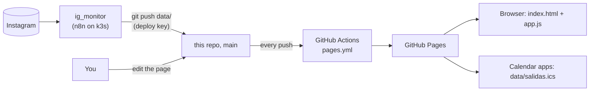
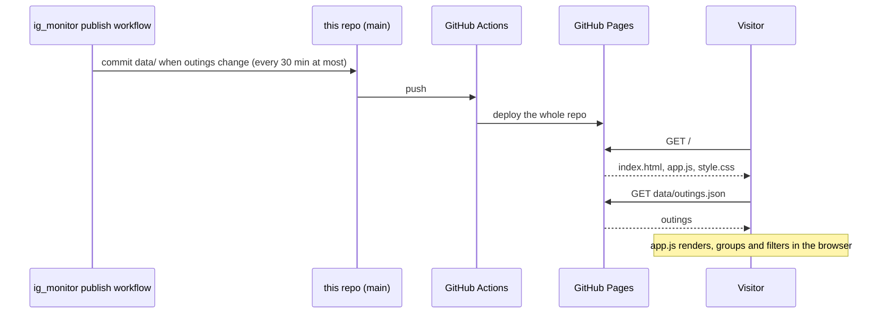
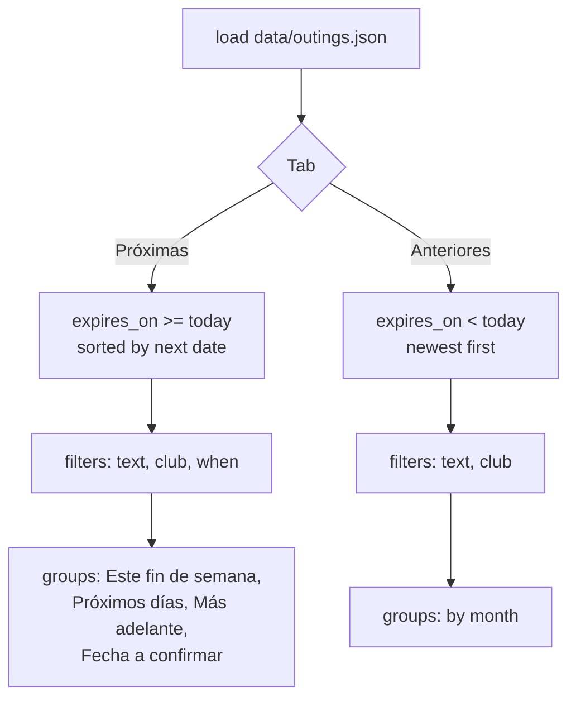

# Salidas de aves

Upcoming (and past) birdwatching outings announced by clubs and groups on Instagram, in one static page, with a calendar feed people can subscribe to.

**Site:** https://guernik.github.io/salidas-de-aves/

The data is produced by [ig_monitor](https://github.com/Guernik/ig_monitor), a set of n8n workflows that fetch the clubs' posts, classify them with Claude and push the outings here. This repo only holds the page and the published data.

## How it works





There is no build step and no server: the page is plain HTML, CSS and JavaScript, and `app.js` reads `data/outings.json` at load time.

## Files

| Path | Owner | What |
|---|---|---|
| `index.html`, `app.js`, `style.css` | edited here | the page |
| `data/outings.json` | ig_monitor | every outing ever found, upcoming and past |
| `data/salidas.ics` | ig_monitor | iCalendar feed, one event per outing date |
| `data/images/` | ig_monitor | the first image of each outing's post |
| `.github/workflows/pages.yml` | edited here | deploys to Pages on every push to `main` |

Don't edit `data/` by hand: ig_monitor regenerates it from its database on every run and would overwrite the change.

### `data/outings.json`

```json
{
  "outings": [
    {
      "key": "coapalermo|2026-12-06",
      "title": "Salida de observación de aves",
      "dates": ["2026-12-06"],
      "start_time": "08:00",
      "location": "Reserva Ecológica Costanera Sur",
      "details": "Inscripción por mensaje directo",
      "expires_on": "2026-12-06",
      "username": "coapalermo",
      "full_name": "COA Palermo",
      "post_url": "https://www.instagram.com/p/...",
      "published_at": "2026-11-27T13:00:00.000Z",
      "caption": "First 600 characters of the post...",
      "image": "images/<post_id>.jpg"
    }
  ]
}
```

An outing is upcoming while `expires_on` (its last date, or 14 days after the post when it has no date) is today or later in Buenos Aires time; otherwise it shows under "Anteriores".

## The page



- **Buscar:** free text over title, location, details and account.
- **Club:** one Instagram account.
- **Cuándo** (upcoming only): this weekend, next 7 days, next 30 days.
- **Suscribirse al calendario:** a `webcal://` link to `data/salidas.ics`, so phones and calendar apps subscribe instead of downloading once.

Dates are always computed in `America/Argentina/Buenos_Aires`, whatever the visitor's timezone.

## Working on the page

```fish
python3 -m http.server 8000
```

Then open http://localhost:8000. Pushing to `main` deploys.
